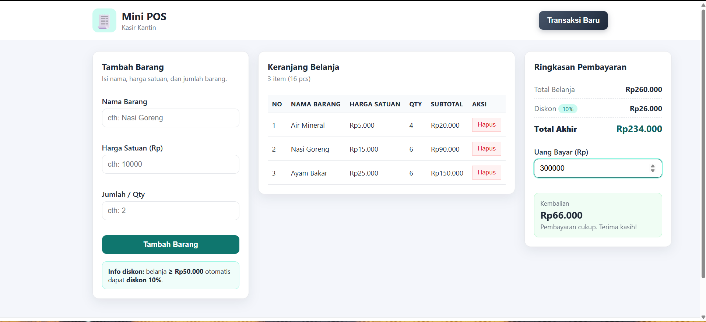
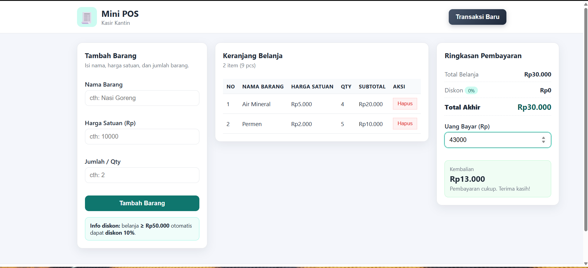
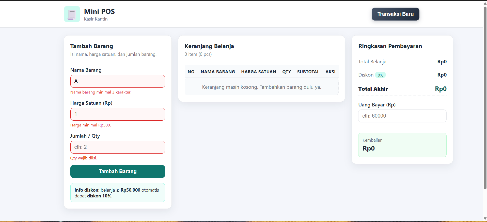

# Mini POS — Kasir & Keranjang Belanja Sederhana

## 1. Identitas

- **Nama Lengkap:** Muhammad Arfa Raditya
- **NIM:** 124140015
- **Kelas:** RB

## 2. Deskripsi Aplikasi

**Mini POS** adalah aplikasi web kasir sederhana untuk **kantin atau toko kampus**.
Kasir dapat mencatat barang yang dibeli mahasiswa, melihat subtotal tiap barang,
total belanja, diskon otomatis, total akhir, uang bayar, dan kembalian — semuanya
dihitung otomatis dengan JavaScript di sisi browser.

**Tujuan aplikasi:**

- Mempercepat proses pencatatan transaksi di kantin kampus.
- Menghindari kesalahan hitung manual (subtotal, diskon, kembalian).
- Memberi contoh penerapan JavaScript dasar: DOM, event, validasi, array,
  perhitungan, dan `localStorage`.
- Tetap bisa dipakai setelah halaman di-refresh karena data tersimpan persisten.

**Studi kasus:**
Mahasiswa membeli beberapa menu kantin (misal Nasi Goreng Rp10.000 × 2 dan
Es Teh Rp5.000 × 3). Kasir menginput tiap barang lewat form, aplikasi menampilkan
tabel keranjang + ringkasan, lalu kasir memasukkan uang bayar dan langsung tahu
kembaliannya. Jika total ≥ Rp50.000, diskon 10% otomatis aktif.

## 3. Cara Menjalankan

Tidak perlu install apa pun. Cukup browser modern (Chrome / Edge / Firefox).

**Cara 1 — dobel-klik (paling mudah):**

1. Buka folder `MuhammadArfaRaditya_124140015_Pertemuan1`.
2. Dobel-klik file `index.html`.
3. Aplikasi terbuka di browser dan siap dipakai.

**Cara 2 — Live Server (VS Code, disarankan):**

1. Buka folder project di VS Code.
2. Install extension **Live Server** (jika belum ada).
3. Klik kanan `index.html` → **Open with Live Server**.
4. Browser membuka alamat seperti `http://127.0.0.1:5500/index.html`.

Struktur file yang dibuka harus berdampingan:

```text
MuhammadArfaRaditya_124140015_Pertemuan1/
├── index.html
├── style.css
├── script.js
├── README.md
├── screenshot/
│   ├── ss1.png
│   ├── ss2.png
│   └── ss3.png
└── modul/
    ├── 01-variabel-kondisional/
    ├── 02-loop-fungsi/
    ├── 03-array-objek/
    └── 04-dom-api/
```

## 4. Daftar Fitur

| No | Fitur | Keterangan |
|----|-------|------------|
| 1 | Validasi input | Nama wajib ≥ 3 karakter; harga angka, positif, min Rp500; qty bulat min 1; error merah di bawah input |
| 2 | Tambah barang | Barang valid masuk tabel, form otomatis reset |
| 3 | Hapus barang | Tombol Hapus per baris, total & localStorage langsung diperbarui |
| 4 | Subtotal | `Harga Satuan × Qty` per baris |
| 5 | Total belanja | Jumlah seluruh subtotal |
| 6 | Diskon otomatis | 10% jika total ≥ Rp50.000, selain itu Rp0 |
| 7 | Total akhir | `Total Belanja − Diskon` |
| 8 | Pembayaran | Input Uang Bayar, kembalian dihitung otomatis (`Uang Bayar − Total Akhir`) |
| 9 | Kembalian aman | Jika uang kurang: kembalian tidak negatif, tampil pesan kekurangan |
| 10 | localStorage | Simpan dengan `JSON.stringify`, baca dengan `JSON.parse`, tetap ada setelah refresh |
| 11 | Reset transaksi | Tombol Transaksi Baru: kosongkan keranjang, total, uang bayar, kembalian, dan hapus localStorage |
| 12 | UI responsif | 3 kolom di desktop, menumpuk rapi di tablet/mobile; format `Rp10.000` dsb. |

## 5. Screenshot

### a. Total belanja lebih dari Rp50.000 (diskon 10% aktif)

- File: `screenshot/ss1.png`
- Isi: 3 item (Air Mineral Rp5.000 × 4, Nasi Goreng Rp15.000 × 6, Ayam Bakar Rp25.000 × 6).
- Total Belanja Rp260.000 → Diskon 10% Rp26.000 → Total Akhir Rp234.000.
- Uang Bayar Rp300.000 → Kembalian Rp66.000.



### b. Total belanja kurang dari Rp50.000 (tanpa diskon)

- File: `screenshot/ss2.png`
- Isi: 2 item (Air Mineral Rp5.000 × 4, Permen Rp2.000 × 5).
- Total Belanja Rp30.000 → Diskon Rp0 (badge 0%) → Total Akhir Rp30.000.
- Uang Bayar Rp43.000 → Kembalian Rp13.000.



### c. Validasi error — semua input tidak memenuhi syarat

- File: `screenshot/ss3.png`
- Isi: Nama "A" (kurang dari 3 karakter), Harga "1" (di bawah minimal Rp500),
  Qty kosong — ketiganya menampilkan pesan error merah dan barang gagal masuk keranjang.



## 6. Penjelasan Teknis Singkat

**Alur validasi (`validateForm()`):**

1. Ambil dan `trim()` nilai nama, harga, qty.
2. Bersihkan error lama (`clearFieldError`).
3. Cek satu per satu:
   - Nama kosong → error; panjang < 3 → error.
   - Harga kosong → error; bukan angka hingga (`Number.isFinite`) → error;
     ≤ 0 → error; < 500 → error.
   - Qty kosong → error; bukan integer (`Number.isInteger`) → error; < 1 → error.
4. Tiap gagal: tampilkan pesan merah + tandai input `.invalid`, kembalikan `false`.
5. `addItem()` membatalkan penambahan jika validasi `false`, sehingga barang
   tidak valid **tidak bisa** masuk keranjang.

**Perhitungan transaksi:**

```text
subtotal    = hargaSatuan × qty                 (calculateSubtotal)
total       = Σ semua subtotal                  (calculateTotal)
diskon      = total × 10%  jika total ≥ 50000,  (calculateDiscount)
              selain itu 0
totalAkhir  = total − diskon
kembalian   = uangBayar − totalAkhir            (calculateChange)
```

Setiap ada perubahan (tambah/hapus/ketik uang bayar) aplikasi memanggil
`renderCart()` → `updateSummary()` → `updateChange()` sehingga tabel, total,
diskon, dan kembalian selalu sinkron. Format Rupiah memakai
`toLocaleString('id-ID')` sehingga tampil `Rp10.000`, `Rp50.000`, `Rp125.000`.

**Mekanisme localStorage:**

- `saveToLocalStorage()` — `localStorage.setItem('miniPosCart', JSON.stringify(cartItems))`
  dipanggil setiap tambah/hapus item.
- `loadFromLocalStorage()` — `JSON.parse(localStorage.getItem('miniPosCart'))`
  dipanggil sekali saat halaman dimuat, dibungkus `try/catch`; jika data rusak
  atau bukan array, keranjang dikosongkan dengan aman.
- `resetTransaction()` — `localStorage.removeItem('miniPosCart')` + kosongkan
  state, form, dan ringkasan.
- Setelah refresh, `loadFromLocalStorage()` + `renderCart()` menghitung ulang
  subtotal, total, diskon, dan total akhir dari data yang tersimpan.

**Fungsi utama di `script.js`:**
`validateForm`, `addItem`, `deleteItem`, `renderCart`, `calculateSubtotal`,
`calculateTotal`, `calculateDiscount`, `calculateChange`, `saveToLocalStorage`,
`loadFromLocalStorage`, `resetTransaction`, plus helper `formatRupiah`,
`updateSummary`, `updateChange`.

Kode memakai `const`/`let` (tanpa `var`), perbandingan `===`, dan
`camelCase` sesuai ketentuan modul.
