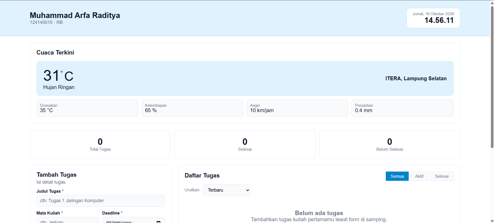
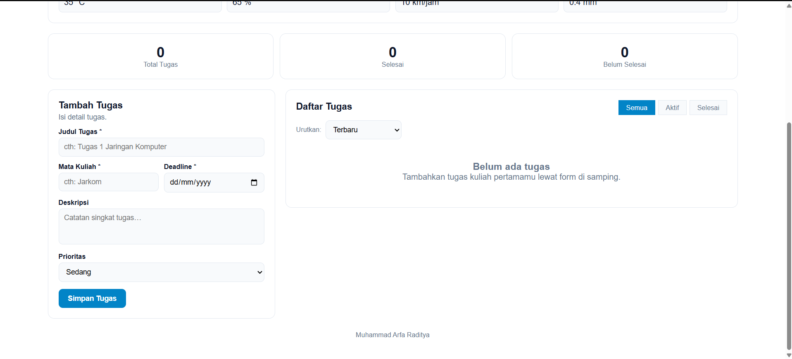
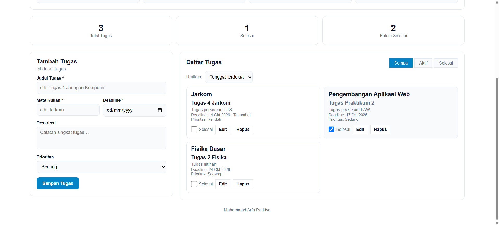

# Personal Dashboard - Tugas Praktikum 2

## Identitas

- **Nama Lengkap:** Muhammad Arfa Raditya
- **NIM:** 124140015
- **Kelas:** RB

## Fitur

- **Header**: nama aplikasi, tanggal + jam lokal live (detik), deskripsi.
- **Cuaca real-time**: suhu °C, kondisi berbahasa Indonesia (terjemahan kode WMO), suhu dirasakan, kelembapan %, angin km/jam, presipitasi mm, lokasi, waktu pembaruan; loading spinner; pesan error + tombol coba lagi; refresh manual + auto-refresh tiap 10 menit.
- **Statistik tugas**: total, selesai, belum selesai (otomatis via `reduce()`).
- **CRUD tugas**: tambah (validasi), baca (kartu + empty state), edit (form terisi + tombol batal), hapus (konfirmasi dengan `confirm`), toggle selesai/aktif via checkbox standar.
- **Kontrol standar HTML**: dropdown Prioritas & Urutkan Daftar memakai `<select>` bawaan browser, input tanggal memakai `<input type="date">` bawaan, toggle selesai memakai checkbox bawaan. Validasi tenggat kosong dijaga oleh `TaskItem.validate`.
- **Filter**: semua / aktif / selesai; **sortir**: tenggat / prioritas / terbaru; penanda tugas terlambat.
- **Penyimpanan**: key `personalDashboardTasks`; tahan refresh; JSON rusak ditangani tanpa crash.
- **Responsive**: desktop 2 kolom, tablet & HP 1 kolom; hover/transisi/toast feedback.

## Sumber API Cuaca

- Dokumentasi: https://open-meteo.com/en/docs
- Endpoint yang dipakai aplikasi:

  ```text
  https://api.open-meteo.com/v1/forecast?latitude=-5.36&longitude=105.31&current=temperature_2m,relative_humidity_2m,apparent_temperature,is_day,precipitation,weather_code,wind_speed_10m&timezone=Asia%2FJakarta
  ```

  Lokasi default: ITERA, Lampung Selatan (-5.36, 105.31), zona waktu Asia/Jakarta.

## Cara Menjalankan

Karena memakai ES modules (`import/export`), **jangan dibuka via `file://`**. Cara menjalankan: buka folder `MuhammadArfaRaditya_124140015_Pertemuan2/` di VS Code → klik kanan `index.html` → *Open with Live Server*.

Butuh koneksi internet untuk fetch API cuaca.

## Screenshot

- **Tampilan awal**: header identitas + widget cuaca real-time dari Open-Meteo:
  
- **Tugas kosong**: daftar tugas saat belum ada data (empty state):
  
- **Tugas terisi**: daftar tugas setelah data ditambahkan:
  

## Fitur ES6+ — Lokasi Kode

| # | Fitur | File & baris |
|---|-------|--------------|
| 1 | `let` / `const` | `js/DashboardApp.js:4-5` (`const STORAGE_KEY/WEATHER_URL`), `:27` (`const ids`), `:83` (`const now`); `js/models/TaskItem.js:51` (`const errors`) |
| 2 | Arrow functions (≥3, dipakai nyata) | `js/DashboardApp.js:28` (`ids.forEach`), `:44` (submit), `:50` (sortir), `:55` (filter), `:141` (`parsed.map`), `:271` (render); `js/main.js:4` (`() => {…}`) |
| 3 | Template literals | `js/DashboardApp.js:271-297` (render kartu tugas), `:278` (format tanggal) |
| 4 | `async/await` + `fetch` | `js/DashboardApp.js:91-108` (`async fetchWeather`, `await fetch`, `await res.json()`) |
| 5 | Class `TaskItem` | `js/models/TaskItem.js:2-56` (constructor, `toggleStatus`, `update`, `isOverdue`, `toJSON`, `fromJSON`, `validate`) |
| 6 | Class `DashboardApp` | `js/DashboardApp.js:17-322` (state, CRUD, storage, render, cuaca) |
| 7 | Destructuring | `js/models/TaskItem.js:3,26,42,50`; `js/DashboardApp.js:103` (`{relative_humidity_2m…}`), `:110` (parameter `renderWeather`), `:188`, `:272` |
| 8 | Spread operator | `js/models/TaskItem.js:47` (`{...obj}`); `js/DashboardApp.js:170` (`{...payload}`), `:176-177` (`{...payload}`, `[...tasks, task]`), `:235` (`[...filtered]`) |
| 9 | `map` / `filter` / `reduce` | `map`: `DashboardApp.js:141,149,169,271`; `filter`: `:216,:233,:234`; `reduce`: `:257-260` (statistik) |
| 10 | `import` / `export` | `export`: `TaskItem.js:2`, `DashboardApp.js:17`; `import`: `DashboardApp.js:2`, `main.js:2`; HTML memakai `<script type="module">` (`index.html`) |

## Penjelasan Singkat

- **`TaskItem`** (`js/models/TaskItem.js`): memodelkan satu tugas — struktur data (id, judul, matkul, deskripsi, tenggat, prioritas, status) plus perilaku (`toggleStatus()`, `update()`, `isOverdue()`, validasi, serialisasi `toJSON/fromJSON`). `DashboardApp` tidak menyentuh objek mentah, selalu lewat class ini.
- **`DashboardApp`** (`js/DashboardApp.js`): pemilik state (`tasks`, `filter`, `sortBy`, `editingId`); mengatur seluruh alur — `init()` → `loadTasks()` → `render()` → `fetchWeather()` + `startClock()` + `bindEvents()`; CRUD (`handleSubmit/startEdit/cancelEdit/deleteTask/toggleTask`); render statistik & daftar; fetch cuaca.
- **`localStorage`**: key tunggal `personalDashboardTasks` (`DashboardApp.js:4,135-150`); setiap mutasi (`handleSubmit`, `toggleTask`, `deleteTask`) memanggil `saveTasks()`; saat start `loadTasks()` mem-parse JSON dalam `try/catch` — data kosong → array kosong, JSON rusak → dihapus & mulai kosong tanpa crash.
- **`async/await`**: `fetchWeather()` (`DashboardApp.js:91-108`) memakai `await fetch()` + `await res.json()` dengan cek `res.ok` dan validasi field, lalu `renderWeather()`; error jaringan/HTTP/respons invalid → `showWeatherState("error")` dengan pesan ramah + tombol coba lagi; tidak ada data palsu saat gagal.
