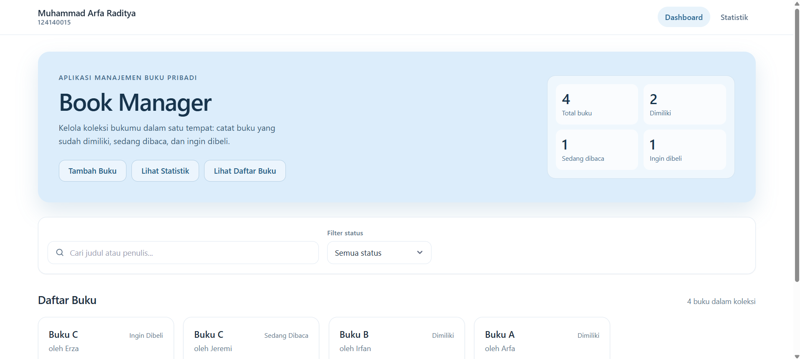
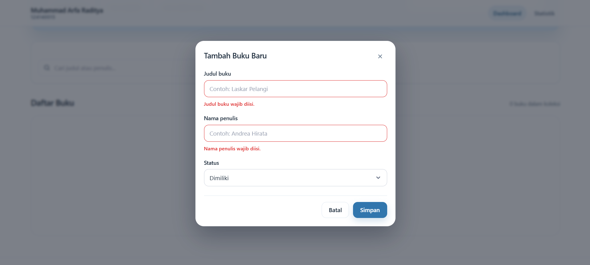
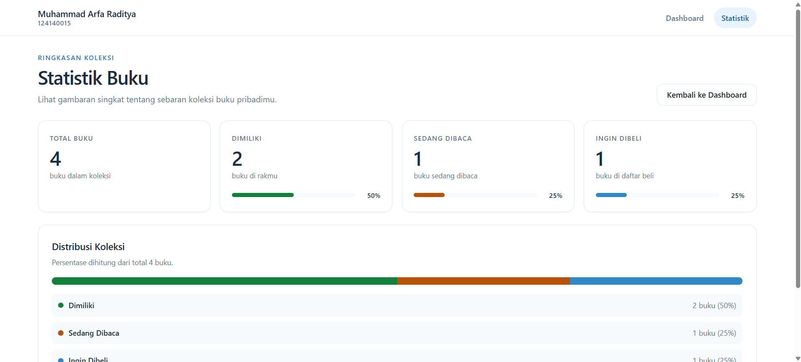

# Book Manager - Tugas Praktikum 3

## Identitas

- **Nama:** Muhammad Arfa Raditya
- **NIM:** 124140015
- **Kelas:** RB

## Fitur Utama

- **Dashboard:** Menampilkan ringkasan jumlah buku berdasarkan status.
- **Manajemen Buku:** Menambahkan, melihat, mengedit, dan menghapus buku.
- **Pencarian dan Filter:** Mencari buku berdasarkan judul atau penulis serta memfilter berdasarkan status.
- **Validasi Formulir:** Memvalidasi input judul dan nama penulis.
- **Statistik Koleksi:** Menampilkan jumlah, persentase, dan distribusi buku.
- **Penyimpanan Otomatis:** Menyimpan data menggunakan `localStorage`.
- **Notifikasi dan Konfirmasi:** Menampilkan notifikasi perubahan data dan konfirmasi sebelum menghapus buku.
- **Desain Responsif:** Mendukung tampilan desktop, tablet, dan perangkat mobile.
- **Unit Testing:** Pengujian menggunakan Vitest dan React Testing Library.

## Screenshot

- **Dashboard dan daftar buku:** menampilkan ringkasan koleksi serta daftar buku yang dikelola.

  

- **Formulir buku:** menampilkan formulir untuk menambahkan buku beserta informasi yang diperlukan.

  

- **Statistik koleksi:** menampilkan jumlah buku dan visualisasi distribusi koleksi berdasarkan status.

  

## Teknologi

- React 19
- Vite
- JavaScript dan JSX
- React Router DOM
- Context API dan React Hooks
- Custom Hooks
- localStorage
- PropTypes
- Vitest dan React Testing Library
- CSS

## Cara Instalasi

Pastikan Node.js dan npm sudah terpasang. Jalankan perintah berikut di terminal pada folder proyek:

```bash
npm install
```

## Cara Menjalankan Aplikasi

Jalankan development server:

```bash
npm run dev
```

Buka alamat lokal yang ditampilkan di terminal, biasanya `http://localhost:5173`.

## Menjalankan Pengujian

Jalankan seluruh unit test:

```bash
npm test
```

Untuk menjalankan pengujian dalam mode watch:

```bash
npm run test:watch
```

## Build Production

Untuk membuat build aplikasi:

```bash
npm run build
```

Untuk menjalankan hasil build secara lokal:

```bash
npm run preview
```
