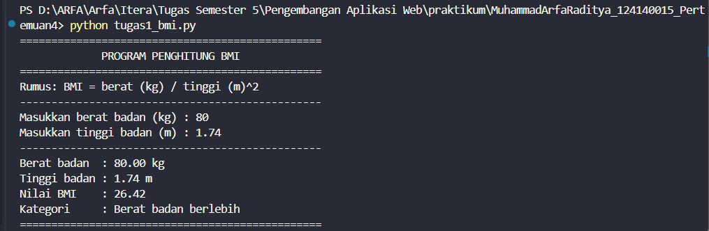
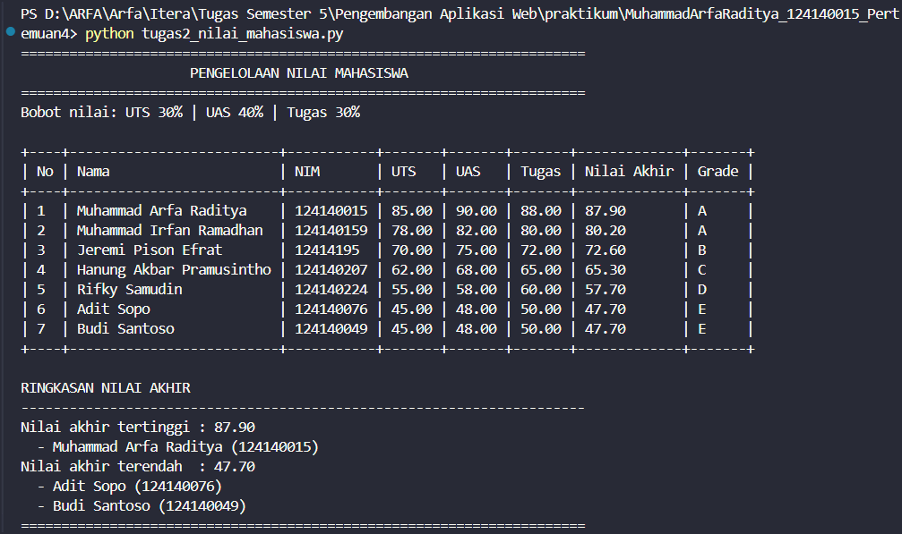
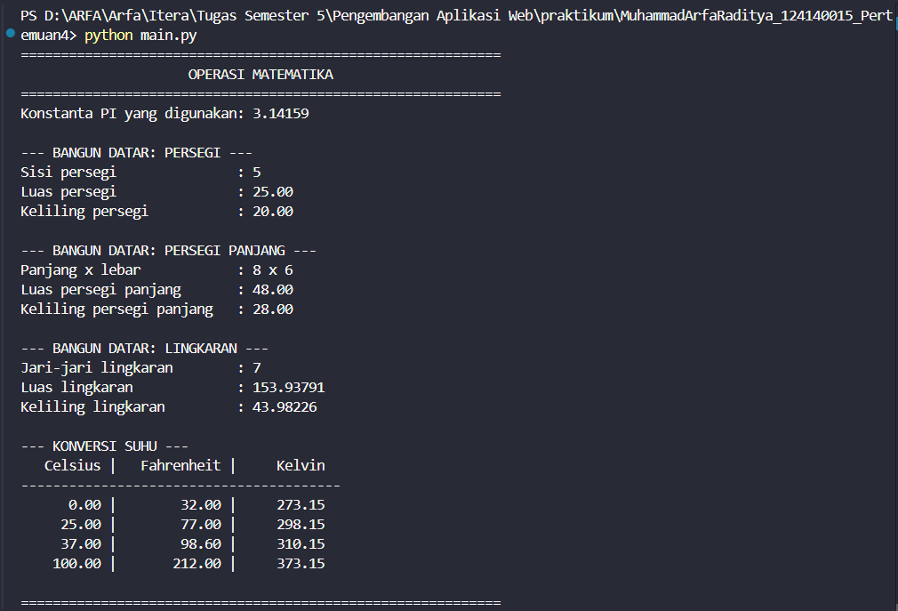

# Python Dasar - Tugas Praktikum 4

## Identitas

- **Nama:** Muhammad Arfa Raditya
- **NIM:** 124140015
- **Kelas:** RB

## Tujuan

1. Memahami dasar-dasar Python: variabel, tipe data, dan operator.
2. Menerapkan struktur kendali `if-elif-else` dan perulangan.
3. Membuat serta menggunakan fungsi.
4. Mengolah struktur data `list` dan `dictionary`.
5. Membuat modul Python kustom dan mengimpornya dengan beberapa cara.

## Deskripsi Tugas

### 1. `tugas1_bmi.py` — Program Penghitung BMI

Program meminta berat badan (kg) dan tinggi badan (m) melalui `input()`,
lalu menghitung `BMI = berat / (tinggi * tinggi)` dan menampilkan kategori:

| Rentang BMI | Kategori |
| --- | --- |
| BMI < 18.5 | Berat badan kurang |
| 18.5 ≤ BMI < 25 | Berat badan normal |
| 25 ≤ BMI < 30 | Berat badan berlebih |
| BMI ≥ 30 | Obesitas |

Fungsi utama:

- `baca_angka(prompt, nama_nilai)` — membaca angka positif; mengulang
  permintaan bila input bukan angka, bukan bilangan *finite* (`inf`/`nan`),
  atau ≤ 0. Koma desimal (mis. `1,70`) otomatis diubah menjadi titik.
- `hitung_bmi(berat_kg, tinggi_m)` — menghitung nilai BMI dan memvalidasi
  kedua parameter.
- `tentukan_kategori(bmi)` — menentukan kategori dengan `if-elif-else`.
- `main()` — menjalankan alur program dan mencetak hasil dengan format
  dua angka desimal.

**Output:**



### 2. `tugas2_nilai_mahasiswa.py` — Pengelolaan Nilai Mahasiswa

Program menyimpan **7 dictionary** data mahasiswa dengan kunci
`nama`, `nim`, `nilai_uts`, `nilai_uas`, dan `nilai_tugas`.

- Nilai akhir = `(30% × UTS) + (40% × UAS) + (30% × Tugas)`.
- Grade: **A** ≥ 80, **B** 70–<80, **C** 60–<70, **D** 50–<60, **E** < 50.
- Data ditampilkan dalam tabel teks rata kolom menggunakan f-string.
- Nilai tertinggi dan terendah ditampilkan; bila ada beberapa mahasiswa
  dengan nilai yang sama, **semuanya** ditampilkan.

Fungsi utama:

- `hitung_nilai_akhir(nilai_uts, nilai_uas, nilai_tugas)`
- `tentukan_grade(nilai_akhir)`
- `buat_baris_tabel(mahasiswa, nomor)` dan `tampilkan_tabel(data)`
- `cari_nilai_ekstrem(data, ambil_tertinggi)` — mengembalikan nilai ekstrem
  beserta seluruh mahasiswa yang memperolehnya.
- `tampilkan_ekstrem(judul, nilai, daftar_mahasiswa)`
- `main()`

**Output:**



### 3. `math_operations.py` + `main.py` — Modul Matematika

`math_operations.py` berisi konstanta `PI = 3.14159` dan delapan fungsi:

| Fungsi | Keterangan |
| --- | --- |
| `luas_persegi(sisi)` | Luas persegi |
| `keliling_persegi(sisi)` | Keliling persegi |
| `luas_persegi_panjang(panjang, lebar)` | Luas persegi panjang |
| `keliling_persegi_panjang(panjang, lebar)` | Keliling persegi panjang |
| `luas_lingkaran(jari_jari)` | Luas lingkaran |
| `keliling_lingkaran(jari_jari)` | Keliling lingkaran |
| `celsius_ke_fahrenheit(celsius)` | Konversi Celsius → Fahrenheit |
| `celsius_ke_kelvin(celsius)` | Konversi Celsius → Kelvin |

Fungsi geometri memvalidasi parameter (harus angka, *finite*, dan > 0)
dengan `TypeError`/`ValueError`. Fungsi konversi suhu memvalidasi bahwa
nilai tidak berada di bawah nol mutlak (−273.15 °C). Modul juga memiliki
blok `if __name__ == "__main__":` untuk pengujian mandiri.

`main.py` memakai **dua cara impor**:

```python
import math_operations
from math_operations import (
    celsius_ke_fahrenheit,
    celsius_ke_kelvin,
    keliling_lingkaran,
    luas_persegi,
)
```

Seluruh delapan fungsi dipanggil dan hasilnya ditampilkan secara terstruktur.

**Output:**



## Struktur Direktori

```text
MuhammadArfaRaditya_124140015_Pertemuan4/
├── .gitignore
├── README.md
├── tugas1_bmi.py
├── tugas2_nilai_mahasiswa.py
├── math_operations.py
├── main.py
└── screenshot/
    ├── soal1.png
    ├── soal2.png
    └── soal3.png
```

## Cara Menjalankan

Buka terminal di dalam folder proyek ini, lalu jalankan:

```bash
python tugas1_bmi.py
python tugas2_nilai_mahasiswa.py
python main.py
```

Jika perintah `python` tidak dikenali, gunakan `python3`. Modul
`math_operations.py` juga dapat diuji mandiri:

```bash
python math_operations.py
```
