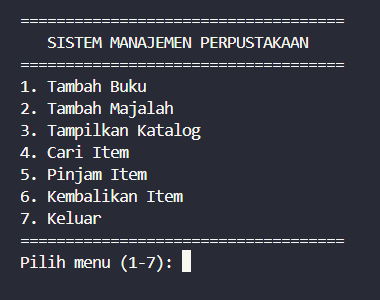
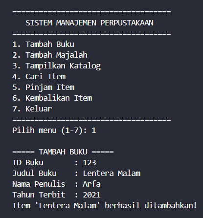
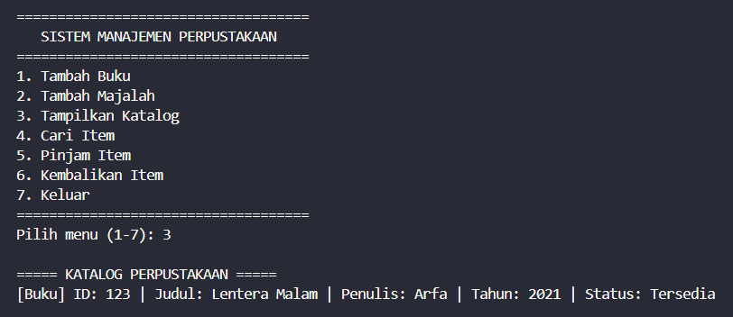
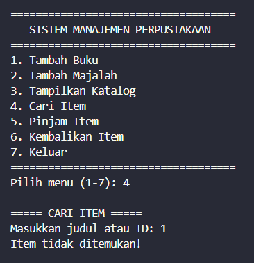
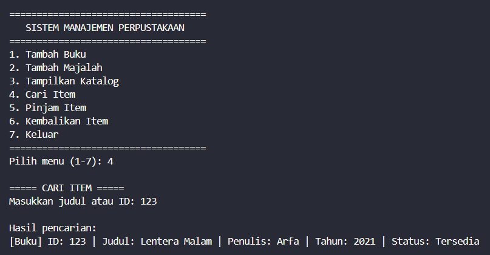

# Sistem Manajemen Perpustakaan - Tugas Praktikum 5

## Identitas

- **Nama:** Muhammad Arfa Raditya
- **NIM:** 124140015
- **Kelas:** RB

## Deskripsi Program

Program ini adalah **sistem manajemen perpustakaan sederhana** berbasis
terminal yang dibangun dengan konsep Object-Oriented Programming (OOP) Python.
Pengguna dapat mengelola koleksi **buku** dan **majalah**, mulai dari
menambahkannya, melihat katalog yang tersedia, mencari item, hingga memproses
peminjaman dan pengembalian.

Alur penggunaan program:

1. Pengguna menambahkan **buku** atau **majalah** beserta data pendukungnya.
2. Katalog menampilkan seluruh item yang statusnya masih **tersedia**.
3. Pengguna dapat **mencari** item berdasarkan judul (sebagian) atau ID
   (harus sama persis).
4. Pengguna meminjam item berdasarkan ID; item yang sedang dipinjam tidak lagi
   muncul di katalog.
5. Saat item dikembalikan, statusnya kembali **tersedia** dan tampil lagi di
   katalog.

Menu yang tersedia:

| Menu | Fungsi |
| --- | --- |
| 1 | Tambah Buku |
| 2 | Tambah Majalah |
| 3 | Tampilkan Katalog |
| 4 | Cari Item |
| 5 | Pinjam Item |
| 6 | Kembalikan Item |
| 7 | Keluar |

### Penerapan 4 Pilar OOP

| Pilar | Implementasi |
| --- | --- |
| **Abstraction** | `library_item.py` mendefinisikan abstract class `LibraryItem(ABC)` dengan abstract method `get_detail()` yang wajib diimplementasikan oleh setiap subclass. |
| **Inheritance** | `Book` dan `Magazine` mewarisi `LibraryItem` melalui `super().__init__()`, lalu menambahkan atribut khusus (`penulis` untuk buku, `edisi` untuk majalah). |
| **Encapsulation** | Atribut internal dilindungi: `_id`, `_judul`, `_tahun_terbit` (protected) serta `__is_dipinjam`, `__koleksi`, `__daftar_pinjaman` (private dengan name mangling). Status item hanya bisa diubah melalui method `pinjam()` dan `kembalikan()`. |
| **Polymorphism** | `Library.tampilkan_katalog()` dan `Library.cari_item()` memanggil `item.get_detail()` tanpa memeriksa tipe objek, sehingga `Book` dan `Magazine` diproses melalui antarmuka yang sama. |

Selain itu, `@property` digunakan sebagai getter read-only untuk `id`, `judul`,
`tahun_terbit`, `is_dipinjam`, `penulis`, dan `edisi`.

## Struktur Direktori

```text
tugas_perpustakaan/
├── library_item.py   # Abstract class LibraryItem + subclass Book & Magazine
├── member.py         # Class Member (pencatatan item yang dipinjam)
├── library.py        # Class Library (koleksi, katalog, pencarian)
└── main.py           # Menu interaktif dan eksekusi program
```

Keterangan berkas:

- **`library_item.py`** — berisi abstract class `LibraryItem` beserta dua
  subclass konkrit, yaitu `Book` dan `Magazine`. Setiap subclass
  mengimplementasikan `get_detail()`.
- **`member.py`** — berisi class `Member` yang menyimpan daftar pinjaman pada
  atribut private `__daftar_pinjaman` dan menyediakan method `pinjam_item()`
  serta `kembalikan_item()`.
- **`library.py`** — berisi class `Library` yang menyimpan koleksi pada atribut
  private `__koleksi`, dengan method `tambah_item()`, `tampilkan_katalog()`,
  dan `cari_item()`.
- **`main.py`** — skrip utama yang menampilkan menu dan menghubungkan seluruh
  class di atas.

## Cara Menjalankan

Buka terminal di dalam folder `tugas_perpustakaan`, lalu jalankan:

```bash
python main.py
```

## Screenshot Output

Tangkapan layar terminal saat program dijalankan, disimpan di folder
`screenshot/`.

### 1. Menu Utama



### 2. Menambah Buku dan Majalah



### 3. Menampilkan Katalog



### 4. Mencari Item

Pencarian dapat dilakukan menggunakan judul (sebagian) atau ID (harus sama
persis). Berikut dua kemungkinan hasilnya.

- **Pencarian Gagal**

  Kata kunci tidak cocok dengan ID maupun judul item mana pun, sehingga program
  menampilkan pesan `Item tidak ditemukan!`.

  

- **Pencarian Berhasil**

  Kata kunci cocok dengan salah satu item, sehingga program menampilkan detail
  item tersebut beserta status ketersediaannya.

  

